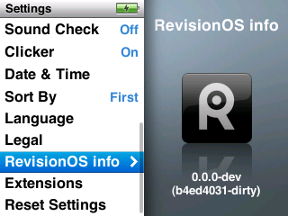
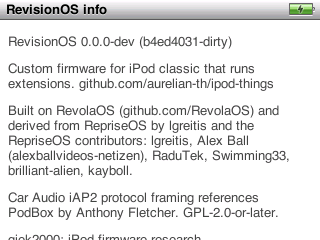
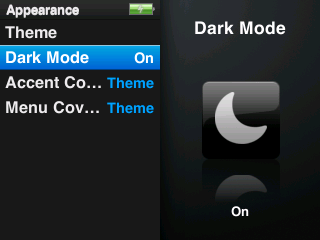
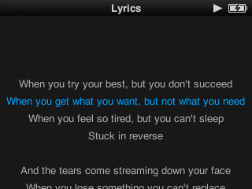
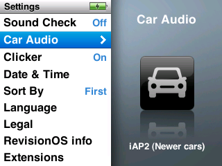
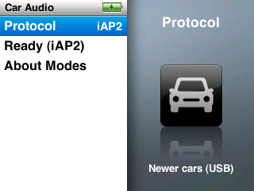

  <picture>
    <source media="(prefers-color-scheme: dark)" srcset="assets/logo/revisionos-banner-dark.svg">
    <source media="(prefers-color-scheme: light)" srcset="assets/logo/revisionos-banner-light.svg">
    
  </picture>

  Plug-and-play custom firmware distribution, extensions, and native games for the Apple iPod Classic (6G, 6.5G, and 7G on firmware 2.0.5, FAT32 storage).

---

RevisionOS builds on the modular **RevolaOS** extension architecture and **RepriseOS** groundwork to add loadable `.rvx` tweaks, native `.eapp` games, and wired USB car integration while keeping Apple's stock firmware intact on the device. Extensions disabled in Settings are not loaded and use zero RAM.

## Screenshots

  
  
  
  
  
  

## What is included

- Car Audio (`iap2.rvx` v1.0.0) adds a wired USB `iAP1 / iAP2` switch under **Settings > Car Audio** with 44.1 kHz UAC1 digital audio, library sync, album artwork up to 512 KiB, and steering-wheel controls. Tested end-to-end on a 2023 Škoda Kodiaq MIB3. Because it follows standard wired USB iAP2 media, it should work on most cars with wired iAP2 iPhone or iPod support; if your head unit does not connect cleanly, open an issue to get setup instructions and the `iap2-diagnostics` build to capture logs.
- Synced `.lrc` lyrics (`lyrics.rvx` v0.2.0) adds a time-synced and static lyrics viewer to Song and Now Playing context menus with smooth auto-scrolling, Click Wheel scrub and snap-back, and Light/Dark Mode support.
- Twenty-two modular `.rvx` extensions covering Dark Mode and `.rvt` themes (`appearance.rvx`), Hold Standby Clock, Silent Remote Volume, Playback Queue, Equalizer, Crossfeed, Compressor, Channels, Clicker Modes, Chapter Menu, File Info, Fast Seek, Long Audio Fix, and Homebrew app/game loading.
- Prebuilt `.eapp` games and apps ready to copy straight onto the iPod under `/Revola/Games/` and `/Revola/Apps/`.

## Repository contents

| Folder | Contents | Guide |
|---|---|---|
| [`Firmware/`](Firmware/) | Non-distributive RevisionOS core and companion recipes (no Apple firmware bytes) | [Installation guide](docs/install.md) |
| [`Extensions/`](Extensions/) | 22 precompiled `.rvx` modules ready to copy to `/Revola/Extensions/` | [Extensions guide](docs/extensions.md) |
| [`Games/`](Games/) | Prebuilt `.eapp` games (`doodlejump/`, `2048/`) and game credits | [Games README](Games/README.md) |
| [`Apps/`](Apps/) | Prebuilt `.eapp` apps (`dice/`) and app credits | [Apps README](Apps/README.md) |
| [`Themes/`](Themes/) | Instructions for custom `.rvt` themes | [Themes README](Themes/README.md) |
| [`source/`](source/) | Complete GPL-3.0 corresponding source for firmware, extensions, games, host tools, and installer | [Source build guide](source/README.md) |
| [`docs/`](docs/) | Guides for installation, extensions, Car Audio, lyrics, and recovery | [Recovery guide](docs/recovery.md) |

## Quick start

1. Install or upgrade RevisionOS using the non-distributive recipes in [`Firmware/`](Firmware/) and your own copy of `iPod_38.2.0.5.ipsw` (supports fresh installs, RepriseOS migrations without touching NOR, and drop-in RevolaOS upgrades). See [docs/install.md](docs/install.md).
2. Copy `.rvx` files from [`Extensions/`](Extensions/) into `/Revola/Extensions/` on your iPod.
3. Copy game and app folders from [`Games/`](Games/) and [`Apps/`](Apps/) into `/Revola/Games/` and `/Revola/Apps/` (with `homebrew.rvx` enabled).
4. Place `.lrc` files under `/Lyrics/` on the drive root (see [docs/lyrics.md](docs/lyrics.md)).
5. Safely eject, unplug, and configure features under **Settings > Extensions**.

## License and open-source credits

Distributed under GPL-3.0-only; see [COPYING](COPYING) and [NOTICE](NOTICE) for full license terms, attribution, and corresponding source details. Complete corresponding source code is included under [`source/`](source/). Apple copyrighted firmware is never distributed here.

RevisionOS builds on [RevolaOS](https://github.com/RevolaOS) (core firmware, extension loader, SDK, theme engine, `eapp-sdk`, QEMU emulator updates, and first-party extensions, GPL-3.0-only), [RepriseOS](https://github.com/lgreitis/osos-lab) and [RepriseOS Installer](https://github.com/lgreitis/repriseos-installer) by lgreitis and contributors (2.0.5 boot chain, reverse engineering, dark palette/artwork, and original game SDK, GPL-3.0-only), [PodBox](https://github.com/anthonyfletcher/podbox) by Anthony Fletcher (iAP2 packet framing and HID reassembly reference, GPL-2.0-or-later), [Rockbox](https://github.com/Rockbox/rockbox) (bootloader, dual-boot installer, hardware drivers, USB helper, and Crossfeed/Channels/Compressor DSP, GPL-2.0-or-later), [wInd3x](https://github.com/freemyipod/wInd3x) by Serge "q3k" Bazanski (BootROM DFU exploit and tooling, GPL-2.0-or-later), [giek2000](https://github.com/giek2000/ipod-classic-firmware-research) (iPod Classic firmware research), [Cupertino Icons](https://github.com/flutter/packages) (MIT), and Khronos OpenGL ES 1.1 / EGL headers (MIT / Apache-2.0).
